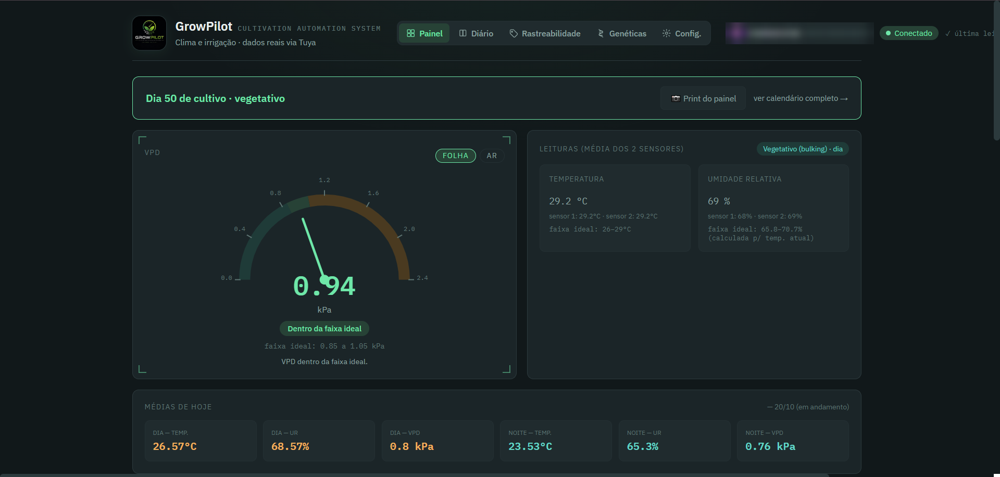
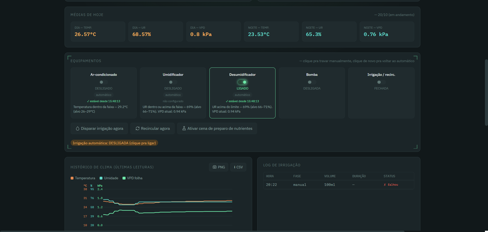
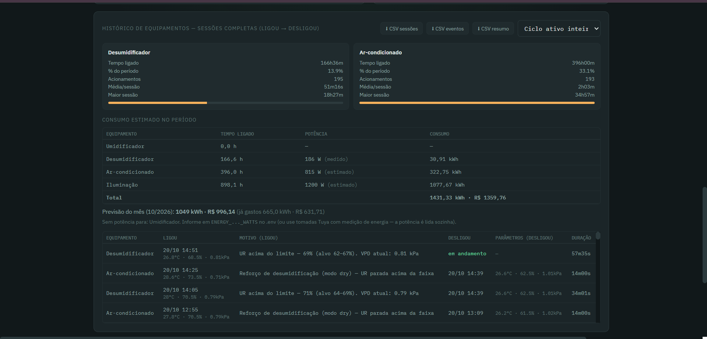
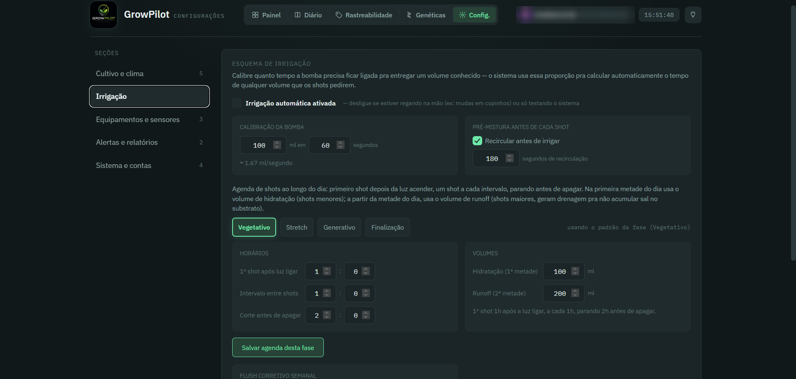

# GrowPilot

**Automação de cultivo indoor com controle de clima por VPD, irrigação por ciclos e monitoramento em tempo real.**

Sistema que desenvolvi do zero e uso em produção, rodando 24 h em um PC dedicado, controlando dispositivos reais (plugs, válvulas, sensores e ar-condicionado por infravermelho) pela nuvem da Tuya.

> Este repositório é uma **vitrine**: mostra o que o sistema faz, como foi construído e as decisões técnicas por trás dele. O código completo é privado.

---

## Em produção

- Roda continuamente em um PC dedicado, gerenciado por **PM2**, com reinício automático.
- Controla equipamentos reais e responde a leituras de sensores a cada minuto.
- Backup diário automático, com cópia para fora do PC e alertas de falha.
- Aviso externo se o sistema cair (heartbeat) e alertas no **Telegram**.

## Funcionalidades

**Controle de clima**
- Cálculo de **VPD** (do ar e "de folha") a partir de temperatura e umidade.
- Faixas-alvo por período (dia/noite) e por fase (modos de *steering*).
- Controle de umidificador, desumidificador e ar-condicionado, com histerese para evitar liga/desliga repetido.
- Diagnóstico de **o que** está tirando o VPD da faixa: temperatura, umidade ou a combinação dos dois.
- Detecção de equipamento **ligado sem efeito** (por exemplo, desumidificador ligado e a umidade não cai) com alerta.

**Irrigação**
- Agendador por ciclos em fases (rampa, manutenção e corte para *dry-back*), acionando bomba e válvulas.
- Recirculação periódica do reservatório.
- Calculadora de fertilização.

**Diário e rastreabilidade**
- Diário de bordo com notas, plantas e calendário.
- Tarefas recorrentes com campos preenchíveis (por exemplo, medição de runoff) que viram registro no diário.
- Eventos do diário marcados sobre o gráfico de clima do dia.
- Genética e rastreabilidade por lote.

**Operação e segurança**
- Autenticação com senhas em **scrypt**, sessões por cookie `HttpOnly` e **perfis de acesso** (master, auxiliar, visitante) validados no servidor.
- Alertas por Telegram, com espaçamento crescente das repetições para não gerar spam.
- Resumo diário automático com imagem do painel.
- Estimativa de **energia e custo**, com previsão mensal e dimerização da iluminação considerada no cálculo.
- Backup e restauração pela própria interface.
- Layout adaptado para celular, com menu lateral e painéis recolhíveis.

## Stack

| Camada | Tecnologia |
|---|---|
| Backend | Node.js, Express |
| Front-end | HTML, CSS e JavaScript (sem framework) |
| Integração | API da Tuya (nuvem), Telegram Bot API |
| Armazenamento | Arquivos JSON locais com backup automático |
| Processo | PM2 |
| Imagens no servidor | `@napi-rs/canvas` (opcional) |

## Decisões técnicas

- **Sem banco de dados externo.** Para um sistema local e de um único site, arquivos JSON com backup diário e restauração testada reduzem a manutenção e as peças que podem falhar.
- **Sem framework no front-end.** As telas são HTML e JavaScript puro, o que mantém o sistema leve e rápido em PCs simples e no celular.
- **Segurança desde o início.** Permissões checadas no servidor, não só na tela, e nenhum segredo no código: tudo vem de variáveis de ambiente.
- **Falhas silenciosas viram alertas.** Backup parado, sensor offline, equipamento sem efeito e queda do sistema geram aviso, porque num cultivo o problema que ninguém vê é o que custa caro.
- **Cota da API respeitada.** O ciclo de controle roda a cada 60 s por padrão, o que reduz bastante o consumo da cota da Tuya.

## Estrutura do projeto

```
index.js              ponto de entrada (servidor Express)
src/
  api.js              rotas da API REST
  controlLoop.js      ciclo de controle do clima
  steering.js         faixas-alvo por fase e período
  vpd.js              cálculo de VPD
  irrigation.js       agendador de irrigação
  alerts.js           alertas (Telegram) com espaçamento
  backup.js           backup diário e restauração
  auth.js             autenticação, sessões e perfis
  tasks.js / journal.js   tarefas e diário
  energy.js           consumo e custo
*.html                telas (painel, diário, configurações, rastreabilidade, genética, admin)
```

Mais detalhes em [`docs/ARQUITETURA.md`](docs/ARQUITETURA.md).

## Código de exemplo

Em [`code-samples/`](code-samples/) estão módulos reais do sistema, para quem quiser ver como eu escrevo código. São trechos de referência: dependem de outros arquivos do projeto e não rodam isolados.

| Arquivo | O que mostra |
|---|---|
| [`tuyaClient.js`](code-samples/tuyaClient.js) | Cliente da API da Tuya: assinatura HMAC-SHA256, renovação de token, envio de comandos a tomadas e válvulas, controle do ar-condicionado por infravermelho e tratamento das armadilhas da API |
| [`vpd.js`](code-samples/vpd.js) | Cálculo de VPD (Tetens), VPD de folha, UR necessária para um VPD-alvo e diagnóstico da causa do desvio |
| [`effectCheck.js`](code-samples/effectCheck.js) | Detecção de equipamento ligado sem efeito, com base na tendência da umidade |
| [`alerts.js`](code-samples/alerts.js) | Alertas por Telegram com espaçamento crescente, limites por hora e por dia |
| [`auth.js`](code-samples/auth.js) | Autenticação com scrypt, sessões `HttpOnly` e perfis de acesso |
| [`backup.js`](code-samples/backup.js) | Backup diário compactado, cópia para pastas externas, restauração segura e alerta de falha |
| [`heartbeat.js`](code-samples/heartbeat.js) | Aviso externo de que o sistema está vivo e aviso de "voltei" após queda de energia |

## Telas

### Painel principal


### Equipamentos


### Energia e custo


### Irrigação

## Sobre mim

Guilherme Silva, estudante de Análise e Desenvolvimento de Sistemas na Fatec Taquaritinga, em busca de oportunidades como desenvolvedor.

- GitHub: [@GuilhermeSilva177](https://github.com/GuilhermeSilva177)

---

© 2026 Guilherme Silva. Todos os direitos reservados. Veja [`LICENSE`](LICENSE).
